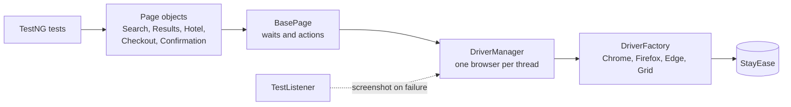

<div align="center">

# 🏨 Selenium + TestNG UI Framework

**Parallel, cross-browser UI tests for StayEase hotel booking, built on the Page Object Model**

    

[](https://github.com/skamirullah/practiceqa-selenium-testng-ui/actions/workflows/ci.yml)  

[What it tests](#-what-it-tests) · [Quick start](#-quick-start) · [How it is built](#-how-it-is-built) · [Structure](#-project-structure) · [Reports](#-reports-and-debugging)

</div>

---

## 👋 Overview

A UI automation framework with Selenium WebDriver and TestNG. It books hotel stays end to end and checks search, filters, pricing and form validation, running tests side by side in separate browsers.

|  |  |
|---|---|
| **App under test** | [StayEase](https://www.practiceqaautomation.com/apps/hotel), a hotel booking app with search, filters, add-ons and checkout |
| **Kind of testing** | UI, test-driven (TDD) style with TestNG |
| **Tests** | 19 tests |
| **Runs in** | Chrome, Firefox or Edge, locally or on a Selenium Grid |

### Highlights

- **Parallel by default.** Three tests at a time, each with its own browser.
- **Fluent page objects.** A booking reads as one chain: search, filter, select room, pay, confirm.
- **No sleeps.** Every action waits for its element; nothing uses `Thread.sleep`.
- **Calculated expectations.** Prices are checked against the rule (room + add-ons + 12% tax), not hard-coded totals.

## 🎯 What it tests

| Area | What is checked |
|---|---|
| Search | Stays listed for a city; destination and check-in date are required |
| Result counts | The count line matches the stays listed, for four cities (data-driven) |
| Filter and sort | Star rating, price low to high, and both together |
| Pricing | Room total, add-ons, 12% taxes and the grand total add up |
| Booking | Pay by card, pay at the hotel, confirmed total equals the checkout total |
| Checkout validation | Empty form, invalid email, invalid phone, policy not accepted |

## 🚀 Quick start

**You need:** Java 17+ and Maven 3.9+. Chrome is used by default; Selenium downloads the matching driver for you.

```bash
git clone https://github.com/skamirullah/practiceqa-selenium-testng-ui.git
cd practiceqa-selenium-testng-ui
mvn test
```

| Command | What it does |
|---|---|
| `mvn test` | Run the full regression suite in parallel |
| `mvn test -Dsuite=testng-smoke.xml` | Run only the smoke tests |
| `mvn test -Dbrowser=firefox` | Run in Firefox (or `edge`) |
| `mvn test -Dheadless=false` | Watch the browser |
| `mvn test -Dgrid.url=http://localhost:4444` | Run on a Selenium Grid |
| `mvn allure:serve` | Open the Allure report |

## 🧱 How it is built



- **Page Object Model with fluent returns.** Each action returns the page you land on, so flows chain naturally.
- **ThreadLocal driver.** `DriverManager` gives each thread its own browser, which makes `parallel="methods"` safe.
- **Factory for browsers.** `DriverFactory` is the only class that knows about Chrome, Firefox, Edge or a Grid.
- **Explicit waits only.** `BasePage` waits for visibility or clickability and scrolls elements clear of the sticky header.
- **Data providers and records.** `Guest.valid().withEmail(...)` and TestNG data providers drive the negative cases.

## 📁 Project structure

```text
src
├── main/java/com/practiceqa/stayease
│   ├── config/Config.java          # settings from -D flags, env vars, then config.properties
│   ├── driver/                     # DriverFactory (which browser), DriverManager (one per thread)
│   ├── pages/                      # BasePage, SearchPage, ResultsPage, HotelPage, CheckoutPage, ConfirmationPage
│   └── data/                       # Guest, Card, Hotels
└── test
    ├── java/com/practiceqa/stayease
    │   ├── base/BaseTest.java      # browser per test
    │   ├── listeners/TestListener.java   # screenshot on failure
    │   └── tests/                  # Search, Results, Pricing, Booking, CheckoutValidation
    └── resources/config.properties
testng.xml                          # full regression, parallel
testng-smoke.xml                    # smoke group only
```

## ⚙️ Configuration

Defaults live in `src/test/resources/config.properties`. Override any of them on the command line (`-Dbrowser=firefox`) or with an environment variable (`BROWSER=firefox`); nothing needs editing to change environment.

| Setting | Default | What it does |
|---|---|---|
| `base.url` | the live site | Site to test. Point it at a local or staging build. |
| `browser` | `chrome` | `chrome`, `firefox` or `edge`. |
| `headless` | `true` | Set to `false` to watch the browser. |
| `timeout` | `10` | Seconds to wait for an element before failing. |
| `grid.url` | empty | Selenium Grid or cloud hub URL. Empty runs a local browser. |

## 📊 Reports and debugging

- **Allure**: run `mvn allure:serve` after a test run for a report with steps, timings and attachments.
- **Failures** attach a screenshot and the page URL to the report.
- **Surefire**: `target/surefire-reports/` holds the TestNG HTML and XML results.

## 🔁 Continuous integration

[GitHub Actions](.github/workflows/ci.yml) runs the suite on every push and pull request, and can be started by hand for Firefox or Edge. Results are uploaded as artifacts.

## 🧪 About the app under test

StayEase lets a guest search by city and date, filter by star rating, compare room types, add extras such as breakfast, and pay by card or at the hotel.

[PracticeQAAutomation](https://www.practiceqaautomation.com) is a free practice site for QA engineers, with realistic apps to automate with Selenium, Playwright and Cypress. All data in these tests is fictional.

## 👤 Author

**Sk Amir Ullah** · Technical Lead, SDET and Test Automation

[Portfolio](https://skamirullah.com) · [LinkedIn](https://linkedin.com/in/skamirullah) · [GitHub](https://github.com/skamirullah) · [PracticeQAAutomation](https://www.practiceqaautomation.com)

## 📄 License

[MIT](LICENSE)
